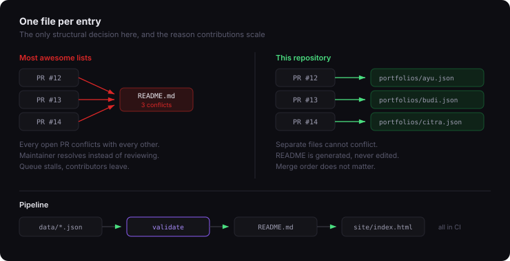

<div align="center">

# Awesome Portfolios


<br/>

[](https://github.com/MhmmdFaizal04/awesome-portfolios/stargazers)
[](#the-list)
[](https://github.com/MhmmdFaizal04/awesome-portfolios/graphs/contributors)
[](CONTRIBUTING.md)

<br/>

> A curated showcase of developer and designer portfolios — 4 of the
> 8 entries link to their source code.
>
> **Submitting yours takes about two minutes** and your pull request cannot
> conflict with anyone else's.

<br/>

[**Browse with filters**](https://mhmmdfaizal04.github.io/awesome-portfolios/site/) · [Submit yours](#submit-your-portfolio) · [Contributing](CONTRIBUTING.md)

</div>

---

<div align="center">

</div>

---

## Submit your portfolio

Two ways, both fine.

**Without touching git** — [open a submission issue](https://github.com/MhmmdFaizal04/awesome-portfolios/issues/new?template=submit-portfolio.yml).
Fill the form and a maintainer opens the pull request for you.

**With a pull request** — add one file:

```jsonc
// data/portfolios/your-name.json
{
  "slug": "your-name",
  "name": "Your Name",
  "url": "https://your-site.com",
  "source": "https://github.com/you/your-site",
  "description": "One sentence on what makes it distinct. Not 'my portfolio'.",
  "stack": ["Next.js", "Tailwind CSS"],
  "tags": ["minimal", "developer"],
  "location": "Jakarta, Indonesia",
  "social": { "github": "yourhandle" },
  "added": "2026-01-20"
}
```

That is the entire change. Do not edit this README — it is generated from
those files by `npm run build`.

Run `npm run validate` first if you have Node installed. It catches the
common mistakes in a second, which is faster than waiting for a review.

---

## Why one file per entry

Most awesome lists have everyone append to a single README. With fifty open
pull requests that means fifty merge conflicts, and the maintainer spends
their time resolving them instead of reviewing.

One file per entry cannot conflict. That is the only structural decision here
and it is the reason this list can absorb contributions faster than it can
review them.

---

## The list

**8 portfolios** — `minimal` 4 · `animated` 3 · `3d` 1 · `interactive` 3 · `dark` 2 · `colorful` 2 · `illustrated` 1 · `experimental` 2 · `blog` 2 · `designer` 1 · `developer` 4

| Portfolio | What makes it notable | Stack | Style |
|-----------|----------------------|-------|-------|
| **[Brittany Chiang](https://brittanychiang.com)** · [source](https://github.com/bchiang7/v4) · [GitHub](https://github.com/bchiang7) | Restrained developer portfolio with a fixed sidebar, sharp typography, and one of the most forked layouts on GitHub. | `Gatsby` `React` `Styled Components` | minimal, dark, developer |
| **[Bruno Simon](https://bruno-simon.com)** · [source](https://github.com/brunosimon/folio-2019) · [GitHub](https://github.com/brunosimon) · [X](https://x.com/bruno_simon) | Portfolio as a drivable 3D world. You steer a car around the projects instead of scrolling past them. | `Three.js` `WebGL` `Cannon.js` | 3d, experimental, interactive |
| **[Cassie Evans](https://www.cassie.codes)** · [source](https://github.com/cassiecodes/cassie-codes-v2) · [GitHub](https://github.com/cassiecodes) · [X](https://x.com/cassiecodes) | SVG and motion work from a GSAP engineer, with animation used to explain rather than decorate. | `Gatsby` `GSAP` `SVG` | animated, illustrated, developer |
| **[Jhey Tompkins](https://jhey.dev)** · [GitHub](https://github.com/jh3y) · [X](https://x.com/jh3yy) | CSS demos pushed well past what most people think the language can do, all documented in the open. | `CSS` `GSAP` `JavaScript` | animated, experimental, colorful |
| **[Josh W. Comeau](https://www.joshwcomeau.com)** · [GitHub](https://github.com/joshwcomeau) · [X](https://x.com/JoshWComeau) | Playful, heavily interactive blog where nearly every article ships a custom widget that teaches the concept. | `Next.js` `React` `Framer Motion` | interactive, animated, blog, colorful |
| **[Lee Robinson](https://leerob.com)** · [source](https://github.com/leerob/site) · [GitHub](https://github.com/leerob) · [X](https://x.com/leeerob) | Content-first personal site that doubles as a reference implementation for the Next.js App Router. | `Next.js` `MDX` `Tailwind CSS` | minimal, blog, developer |
| **[Paco Coursey](https://paco.me)** · [GitHub](https://github.com/pacocoursey) · [X](https://x.com/pacocoursey) | Extremely spare personal site from the author of cmdk, where restraint is the entire design decision. | `Next.js` `MDX` | minimal, dark, developer |
| **[Rauno Freiberg](https://rauno.me)** · [GitHub](https://github.com/raunofreiberg) · [X](https://x.com/raunofreiberg) | Interface design studies with unusually precise attention to micro-interaction timing and easing. | `Next.js` `React` `CSS` | minimal, interactive, designer |

---

## Style tags

Tags describe how a portfolio *feels*. The stack field already covers what it
is built with.

`minimal` · `brutalist` · `animated` · `3d` · `interactive` · `typography` · `dark` · `colorful` · `illustrated` · `experimental` · `blog` · `designer` · `developer`

The list is closed on purpose. Free-form tags drift into fifty synonyms for
"clean" within a month and the filters stop being useful. If something genuinely
does not fit, open an issue and we will discuss adding it.

---

## Removal

If your portfolio is listed and you would rather it were not, open an issue or
email the maintainer. It comes down the same day, no questions asked.

---

## Licence

[CC0 1.0](LICENSE) — public domain. The listed portfolios belong to their
respective authors.

---

<div align="center">

<a href="https://github.com/MhmmdFaizal04/awesome-portfolios/graphs/contributors">
  
</a>

<br/><br/>

Maintained by [MhmmdFaizal04](https://github.com/MhmmdFaizal04)

<sub>This file is generated. Edit `data/portfolios/`, not this.</sub>

</div>
